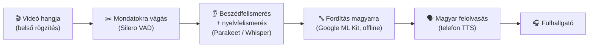

# 🎧 Szinkrontolmács (Android)

A telefonon lejátszott videó vagy film hangját élőben **magyarra fordítja**, és **magyarul mondja a fülhallgatódba**, mint egy szinkrontolmács.

- **Forrásnyelvek:** angol, spanyol, orosz, német, francia, olasz – **automatikus nyelvfelismeréssel**
- **Ingyenes és offline:** az első letöltés után internet nélkül, a telefonon fut
- **Telefon:** Android 10 vagy újabb (fejlesztve: Samsung Galaxy S24 Ultra)

---

## 📥 Letöltés

👉 **[A legújabb APK letöltése](https://github.com/nincsmega71/Szinkrontolmacs/releases/latest/download/Szinkrontolmacs.apk)**

Az összes verzió a [Releases](https://github.com/nincsmega71/Szinkrontolmacs/releases) oldalon található.

---

## 🔧 Telepítés

1. Nyisd meg a **telefonon** a fenti letöltési linket.
2. A letöltés végén koppints a **Szinkrontolmacs.apk** fájlra (értesítési sáv vagy *Saját fájlok → Letöltések*).
3. Ha a telefon rákérdez, engedélyezd a **„Telepítés ismeretlen forrásból”** lehetőséget a böngészőnek vagy a Saját fájloknak.
4. Ha a **Play Protect** figyelmeztet, válaszd a **„Részletek” → „Telepítés mindenképp”** lehetőséget. A Play Áruházon kívüli saját appoknál ez normális.
5. Frissítéskor az új APK-t egyszerűen telepítsd a régi fölé. A letöltött modellek és a beállítások megmaradnak.

---

## 🚀 Első beállítás (csak egyszer kell)

### 1. Beszédfelismerő modell kiválasztása és letöltése

| Modell | Méret | Mikor válaszd |
|---|---|---|
| **Legjobb (Parakeet v3)** ⭐ | kb. 490 MB | Ajánlott. Amerikai angolra is jó, gyors és pontos |
| **Pontos (Whisper small)** | kb. 360 MB | Tartalék, ha a Parakeet valamiért nem tetszik |
| **Gyors (Whisper base)** | kb. 160 MB | Ha kevés a hely, gyengébb pontossággal |

Koppints a **„Modellek letöltése”** gombra. **Wi-Fi ajánlott**, mert a beszédfelismerő mellett a 6 nyelv fordítója is letöltődik (kb. 200 MB).

### 2. Magyar felolvasó hang

Ha az app azt írja, hogy **nincs magyar hang**, koppints a **„Felolvasó beállítások megnyitása”** gombra, és tölts le magyar hangot.

> 💡 **Természetesebb hang:** *Beállítások → Általános kezelés → Szövegfelolvasó* → próbáld ki a **Samsung** és a **Google beszédszolgáltatás** motort is, és válaszd azt, amelyik jobban tetszik.

---

## ▶️ Használat

1. Tedd fel a **fülhallgatót**.
2. Nyisd meg a Szinkrontolmácsot, és nyomd meg az **INDÍTÁS** gombot.
3. Engedélyezd a **hangrögzítést** és az **értesítéseket**.
4. A felugró ablakban válaszd a **„Teljes képernyő”** lehetőséget, majd az **Indítás** gombot.
   (A képernyőt nem rögzíti, csak a lejátszott hangot hallgatja.)
5. Nyisd meg a videót (YouTube, böngésző, videólejátszó…), és indítsd el.
6. A magyar fordítás pár másodperc késéssel megszólal a fülhallgatóban.
7. **Leállítás:** az appban a **LEÁLLÍTÁS** gombbal, vagy az értesítési sávban a **„Leállítás”** gombbal.

### ⚙️ Beállítások

- **Felolvasás sebessége:** ha a magyar hang lemarad, növeld (pl. 1,3×).
- **Eredeti hang halkítása:** amíg a magyar szól, a film hangja halkabb. Ha a videó ettől megáll, kapcsold ki.

### 📊 Állapotsor (az INDÍTÁS gomb alatt)

```
Fut – angol → magyar
Mondat: 3.2 s, feldolgozás: 0.8 s
Hallott: I told you we should have left earlier.
Magyarul: Mondtam, hogy korábban kellett volna indulnunk.
```

- **Hallott:** amit az eredeti nyelven felismert. Ha ez hibás, a felismerés a gyenge pont (próbálj másik modellt).
- **Magyarul:** a fordítás. Ha a „Hallott” jó, de ez furcsa, a fordító hibázott.
- **Feldolgozás:** ha tartósan 1,5 mp fölött van, válassz gyorsabb modellt.

---

## 🧠 Hogyan működik?



Ha a fordító lemarad, gyorsabban olvas, vagy a régi mondatot kihagyja, hogy szinkronban maradjon a képpel.

---

## ⚠️ Korlátok

- **Kb. 2–4 mp késés:** ki kell várnia a mondat végét, mielőtt fordít.
- **Netflix, Disney+, HBO Max, Amazon Prime** és hasonló appok **tiltják** a hangjuk rögzítését, ott nem működik. YouTube, böngésző, VLC és saját videófájlok működnek.
- **Gépi hang:** kicsit robotos, és nem különíti el, ha egyszerre többen beszélnek.
- Erős háttérzene vagy zaj mellett romlik a felismerés.

---

## ❓ Hibaelhárítás

| Jelenség | Megoldás |
|---|---|
| Nem szól semmi | Ellenőrizd, hogy a „Teljes képernyő” lehetőséget választottad-e, és hogy a videó appja nem tiltja-e a rögzítést (pl. Netflix) |
| „Nincs magyar felolvasó hang” | Telepíts magyar hangot a Szövegfelolvasó beállításaiban |
| Sokat késik | Növeld a felolvasás sebességét, vagy válts gyorsabb modellre |
| A videó megáll, amikor a magyar megszólal | Kapcsold ki az „Eredeti hang halkítása” lehetőséget |
| Rossz nyelvet ismer fel | Rövid mondatoknál előfordul; a következő mondatoknál általában helyreáll |
| Letöltési hiba | Próbáld újra Wi-Fi-n, a már letöltött részeket nem tölti le újra |

---

## 🛠️ Fejlesztőknek

- Kotlin, Android (minSdk 29), [sherpa-onnx](https://github.com/k2-fsa/sherpa-onnx) 2.0.0, Google ML Kit Translate + Language ID
- Minden `main` ágra küldés után a GitHub Actions lefordítja az APK-t, és új Release-t készít.
- Android Studióban is megnyitható; a fordítás előtt a `sherpa-onnx-2.0.0.aar` fájlt az `app/libs/` mappába kell tenni (link: `.github/workflows/build.yml`).
